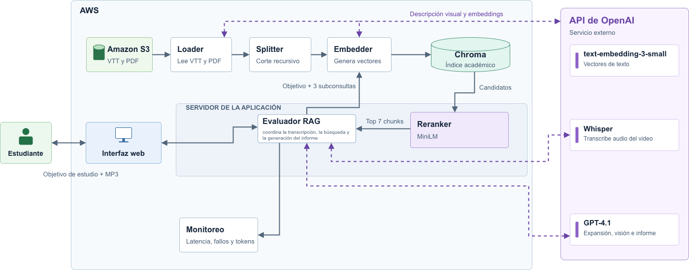

# Ejercicio 3 · Responsible AI, Safety y puesta en producción

Nuestro sistema recibe un objetivo de estudio y el audio de un video. Whisper transcribe el audio, el objetivo se expande en tres subconsultas que buscan en Chroma sobre los materiales de la cátedra, un CrossEncoder reordena los candidatos y GPT‑4.1 recibe los 7 mejores junto con la transcripción. El resultado indica qué contenidos están cubiertos, parciales, sin evidencia en el video o sin respaldo suficiente en la clase.

## 1. Responsible AI y Safety

### 1.1 Principios de Responsible AI

Estos son algunos de los principio que aplicarían a nuestro sistema
| Principio | Riesgo en nuestro sistema | Medidas actuales y propuestas |
| --- | --- | --- |
| Transparencia y supervisión humana | El estudiante puede tomar el informe como definitivo. En la prueba de cierre, todas las citas eran localizables. El informe recomendó una slide para estudiar la secuencia completa de tokenización, IDs y embeddings, aunque el diagrama de esa slide omitía la asignación de IDs. | El informe ya muestra las citas disponibles junto a cada estado y distingue cuándo falta evidencia del video o respaldo de clase. Proponemos agregar un botón por fila para reportar estados incorrectos o citas que no respaldan lo escrito e incorporar esos casos a la evaluación. |
| Equidad y robustez | Whisper puede perder evidencia con ciertos acentos, ruido o música. El reranker, entrenado para ordenar textos en inglés, podría evitar pasajes relevantes en español. | En seis recortes del video de Embeddings, Whisper obtuvo una tasa de error de palabras (WER) del 5,87 %. Ampliar la prueba a otros videos con transcripciones de referencia y comparar el WER y el acierto de los estados por acento y calidad de audio. Limitar la duración del audio. |
| Privacidad de datos | Algunos VTT de clase identifican a quienes hablan. OpenAI recibe el audio para transcribir y la transcripción y los pasajes de clase para generar el informe. | Quitar los nombres antes de indexar y pedir permiso para usar las grabaciones de clase. Informar qué datos se envían y fijar plazos de borrado para el audio y la transcripción, incluso si se guarda para reutilizarla. |

### 1.2 Safety

Un video puede incluir instrucciones habladas que intenten alterar su evaluación. Es un caso de prompt injection. Para reducir el riesgo, el prompt actual presenta la transcripción en un bloque separado e indica que las fuentes se traten como datos. Probaríamos el mismo video con y sin una instrucción ajena al contenido y revisaríamos si cambian los estados o el respaldo de las citas.

También validaríamos la estructura y los estados permitidos. El sistema ya marca el informe con «Requiere revisión» cuando detecta un ID de cita ausente en la entrada. El respaldo que aporta cada cita se comprueba al leer la fuente.

## 2. Estrategias para poner el sistema en producción

Proponemos desplegar en AWS la interfaz web cada modulo. La indexación se ejecutaría cuando cambie el material de clase y el Evaluador RAG se ejecutaría por cada video. Ambos flujos usan la API externa de OpenAI.

### 2.1 Indexación

Amazon S3 guardaría los VTT de clase y los PDF de apuntes y diapositivas. El Loader lee el texto y, para las diapositivas, añade una descripción visual generada con GPT‑4.1. El Splitter aplica el corte recursivo de hasta 160 tokens con 10 de solapamiento y el Embedder genera los vectores con `text-embedding-3-small`. Chroma guardaría en disco persistente los vectores y los chunks con su fuente, página o intervalo. El material y la configuración de indexación permitirían reconstruir el índice.

### 2.2 Servicio

La interfaz web estaría disponible para los estudiantes. El servidor recibiría el objetivo, guardaría el MP3 y procesaría la evaluación. El Evaluador RAG envía el audio a Whisper para obtener el VTT y usa GPT‑4.1 para generar tres subconsultas. El mismo Embedder que se usa para indexar convierte el objetivo y las subconsultas en vectores para buscar en Chroma. El reranker MiniLM, reordena los candidatos y devuelve los siete mejores chunks. GPT‑4.1 recibe esos chunks y el VTT del video para generar el informe con citas.

### 2.4 Monitoreo

En producción implementaríamos un servicio de monitoreo para registrar la latencia, los errores y el consumo de tokens.
